# Self-Training for Indonesian Tweet Sentiment Classification

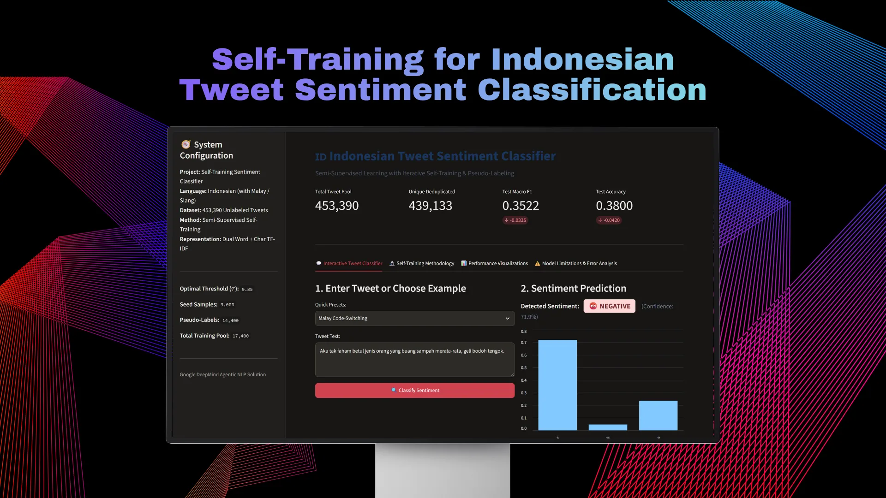


## Project Overview

This project implements a reproducible semi-supervised Natural Language Processing (NLP) pipeline for three-class sentiment classification (**Positive**, **Negative**, and **Neutral**) on **453,390 unlabeled Indonesian tweets**. Starting without ground-truth labels, the system bootstraps a weak-supervision seed corpus via an audited academic sentiment lexicon (InSet), trains a dual word-and-character TF-IDF Logistic Regression baseline, and evaluates iterative confidence-based pseudo-labeling across multiple probability thresholds alongside an interactive Streamlit demonstration interface.

## Problem Statement & Objectives

Social media text in Indonesia exhibits informal *bahasa gaul* slang, non-standard orthography, dialectal code-switching (Indonesian, Javanese, Sundanese, and Malaysian Malay), and pervasive negation variants, while large real-world corpora often arrive completely unlabeled. Manually annotating hundreds of thousands of tweets is costly, whereas naive self-training on noisy microblogs risks confirmation bias and majority-class collapse.

- Audit and conservatively normalize all 453,390 raw tweet records while preserving sentiment-bearing negations, slang, and expressive tokens (`haha`, `wkwk`, `huhu`).
- Construct a leakage-free evaluation protocol by isolating 1,000 deduplicated tweets (500 Validation, 500 Test) under `random_state=42` prior to any training or pseudo-labeling.
- Correct false-polarity artifacts in the raw InSet Lexicon by pruning 59 grammatical function words and introducing syntactic negation windows and intensifier scaling.
- Train a seed-only TF-IDF Logistic Regression baseline and benchmark iterative self-training across confidence thresholds ($\tau \in \{0.85, 0.90, 0.95\}$) with per-class selection caps.
- Conduct structured quantitative and linguistic error analysis on the isolated test set and deliver an interactive Streamlit classifier with publication-grade visualizations.

## Data & Input Sources

The primary corpus is `dataset/original/Indonesian Sentiment Tweet Dataset Unlabeled.csv`, a headerless single-column file containing 453,390 raw Indonesian tweets (`tweet_000000` to `tweet_453389`) with zero missing values and zero pre-existing sentiment labels. After Unicode normalization, URL/mention stripping, and deduplication, 439,133 clean unique records remain (439,132 valid non-empty unique tweets partitioned into 500 validation, 500 test, 3,000 balanced weak-seed training samples, and 435,132 unlabeled pool records, of which 150,000 are sampled for iterative self-training). External lexical resources in `dataset/lexicon/` support weak supervision and colloquial normalization.

| Attribute | Description |
| :--- | :--- |
| **Dataset / Input Source** | Indonesian Sentiment Tweet Dataset Unlabeled (`dataset/original/Indonesian Sentiment Tweet Dataset Unlabeled.csv`) |
| **Lexicon Resources** | InSet Positive (`dataset/lexicon/inset_positive.tsv`), InSet Negative (`dataset/lexicon/inset_negative.tsv`), Colloquial Lexicon (`dataset/lexicon/colloquial_lexicon.csv`) |
| **Format** | Headerless CSV (raw), Gzipped CSV (`.csv.gz`), CSV, TSV, JSON |
| **Samples / Records** | 453,390 raw records; 439,132 valid deduplicated unique tweets (3,000 seed train, 500 val, 500 test, 435,132 unlabeled pool) |
| **Features / Input Shape** | Raw text strings (mean 74.72 chars raw / 74.42 chars cleaned) vectorized into 30,000 sparse TF-IDF features |
| **Target / Label** | 3-class sentiment (`positive`, `negative`, `neutral`) via InSet weak supervision (seed) and dual-annotator silver consensus (val/test) |

## Data Preprocessing & Feature Engineering

Implemented in [`src/data_preprocessing.py`](src/data_preprocessing.py) and [`src/train_baseline.py`](src/train_baseline.py), text normalization standardizes noisy microblog artifacts without stripping negation particles, while feature extraction combines word-level and character-within-word-boundary (`char_wb`) TF-IDF representations via Scikit-learn `FeatureUnion`. In addition, [`src/labeling.py`](src/labeling.py) blacklists 59 high-frequency grammatical function words (`yang`, `aku`, `dia`, `dari`, `itu`, etc.) from the InSet Lexicon and models 3-token preceding negation windows and local intensifiers/diminishers.

| Stage / Component | Input | Transformation & Configuration | Output |
| :--- | :--- | :--- | :--- |
| **Text Normalization** | Raw tweet strings (`text_raw`) | NFKC Unicode normalization, URL/mention removal, `#` stripping, laughter/crying standardization, 3+ char elongation collapse, slang/negation mapping | Normalized text (`text_clean`) |
| **Deduplication & Partitioning** | Cleaned tweets | Exact and normalized duplicate tagging (14,257 removed), non-empty filter, seed-42 split isolating Val/Test before seed selection | Disjoint splits in `dataset/processed/` |
| **Lexicon Weak Labeling** | `text_clean` + InSet TSVs | 59-word grammatical blacklist, 3-token negation inversion ($-0.9\times$ / $+0.7\times$), $1.5\times$ intensifier / $0.7\times$ diminisher scaling | Balanced 3,000-tweet seed set & silver eval sets |
| **Word TF-IDF** | `text_clean` | `ngram_range=(1, 2)`, `min_df=2`, `max_features=12000`, `sublinear_tf=True` | 12,000 sparse word n-gram features |
| **Character-WB TF-IDF** | `text_clean` | `analyzer='char_wb'`, `ngram_range=(3, 5)`, `min_df=5`, `max_features=18000`, `sublinear_tf=True` | 18,000 sparse subword features |

1. Load raw headerless CSV with `header=None` and assign deterministic identifiers (`tweet_000000`–`tweet_453389`).
2. Clean each tweet with `clean_tweet()` and compute raw/cleaned character and word-count audit metrics.
3. Deduplicate normalized strings, isolate 1,000 random evaluation tweets (500 validation, 500 test), and annotate them via dual-annotator consensus (`InSetSentimentScorer` and `rule_heuristic_annotator`).
4. Sample 3,000 high-confidence ($\ge 0.85$) balanced weak seeds (1,000 per class) strictly from the remaining training pool and vectorize text with the 30,000-dimensional `FeatureUnion`.

## Tech Stack

| Category | Technology | Purpose |
| :--- | :--- | :--- |
| **Programming Language** | Python | Core implementation for preprocessing, modeling, evaluation, and UI |
| **ML Framework** | Scikit-learn | TF-IDF `FeatureUnion`, `LogisticRegression`, `DummyClassifier`, evaluation metrics |
| **Data Processing** | Pandas, NumPy, SciPy | Tabular corpus auditing, gzip CSV management, sparse matrix operations |
| **Model Persistence** | Joblib | Serialization and loading of fitted baseline and self-trained pipelines |
| **Visualization** | Matplotlib, Seaborn | Generation of 11 publication-grade audit, training, and error plots |
| **Interactive Application** | Streamlit | Local web interface for live tweet classification and metric inspection |

## Machine Learning Approach

The project adopts a **Semi-Supervised Learning** paradigm centered on **iterative self-training with confidence-thresholded pseudo-labeling**. Because the source corpus contains zero ground-truth labels, a weak-supervision bootstrap establishes an initial seed classifier, which then iteratively labels confident candidates from a 150,000-tweet unlabeled pool subject to per-class selection caps to prevent majority-class collapse.

| Attribute | Project Implementation |
| :--- | :--- |
| **Learning Paradigm** | Semi-Supervised Learning (Weak Supervision + Iterative Self-Training) |
| **Problem Domain** | Indonesian Social Media Natural Language Processing |
| **ML Task** | Multi-Class Sentiment Classification (`positive`, `negative`, `neutral`) |
| **Input** | Normalized Indonesian tweets (30,000 combined word and character TF-IDF features) |
| **Target / Output** | Discrete sentiment label and 3-class probability distribution |
| **Approach** | Lexicon-bootstrapped seed training followed by capped confidence-threshold pseudo-labeling ($\tau \in \{0.85, 0.90, 0.95\}$) |

## Model Overview

The primary model is a Scikit-learn `Pipeline` pairing a 30,000-feature dual TF-IDF `FeatureUnion` with an $L_2$-regularized multinomial `LogisticRegression` classifier (`C=1.0`, `solver='lbfgs'`, `max_iter=1000`, `random_state=42`). Two supervised models trained on different label sets are compared against a `DummyClassifier(strategy='most_frequent')` lower bound: the **Seed-Only Baseline** trained on 3,000 weak seeds and the **Self-Trained Final Model** retrained on 3,000 seeds plus 14,400 pseudo-labels.

| Model | Role | Feature Representation | Training Data |
| :--- | :--- | :--- | :--- |
| **Dummy Majority Classifier** | Empirical lower bound | None (most-frequent class prior) | 3,000 seed labels |
| **Seed-Only Logistic Regression** | Baseline classifier | Dual Word (12k) + Char-WB (18k) TF-IDF | 3,000 balanced weak-seed tweets |
| **Self-Trained Logistic Regression** | Primary semi-supervised model | Dual Word (12k) + Char-WB (18k) TF-IDF | 3,000 seeds + 14,400 pseudo-labels ($\tau=0.85$) |

## ML Workflow

The end-to-end experimental workflow is documented in [final_report.md](final_report.md) and implemented across six modular Python scripts:

1. **Data Audit & Normalization ([`src/data_preprocessing.py`](src/data_preprocessing.py)):** Load the headerless 453,390-tweet CSV, normalize noise and colloquial slang, log corpus statistics to `dataset/processed/audit_summary.json`, and export `dataset/processed/cleaned_tweets.csv.gz`.
2. **Leakage-Free Partitioning & Weak Labeling ([`src/labeling.py`](src/labeling.py)):** Deduplicate records, hold out 500 validation and 500 test tweets (dual-annotator silver consensus), extract 3,000 balanced seed samples, and save `dataset/seed_labels.csv` and `dataset/processed/splits_metadata.json`.
3. **Seed Baseline Training ([`src/train_baseline.py`](src/train_baseline.py)):** Fit the Dummy Majority Classifier and Seed-Only Logistic Regression baseline on `train_seed.csv`, evaluate on `val_set.csv`, and persist `models/baseline_model.joblib` and `metrics/baseline_metrics.json`.
4. **Iterative Self-Training & Threshold Search ([`src/self_training.py`](src/self_training.py)):** Run 4-iteration self-training loops over 150,000 unlabeled tweets across $\tau \in \{0.85, 0.90, 0.95\}$ with a 1,200-per-class iteration cap, selecting $\tau=0.85$ (14,400 pseudo-labels) and saving `models/final_model/model.joblib` and `models/model_metadata.json`.
5. **Isolated Test Evaluation & Error Analysis ([`src/evaluation.py`](src/evaluation.py)):** Benchmark Dummy, Seed-Only Baseline, and Self-Trained Final models on the untouched 500-tweet test set and categorize all 310 errors into five linguistic failure modes in `metrics/error_analysis.json`.
6. **Visualization & Interactive Serving ([`src/visualization.py`](src/visualization.py), [`streamlit/streamlit_app.py`](streamlit/streamlit_app.py)):** Render 11 analytical figures (`figures/`) and launch the interactive Streamlit demo for real-time tweet preprocessing and sentiment inference.

## ML Pipeline Architecture

The pipeline strictly isolates the 1,000-record evaluation partition before weak seed selection and iterative pseudo-labeling so that no duplicate or test tweet ever enters the self-training pool.

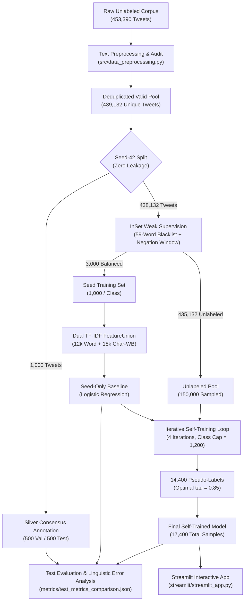

## Model Training & Configuration

Training is configured deterministically in [`src/train_baseline.py`](src/train_baseline.py) and [`src/self_training.py`](src/self_training.py). The base classifier uses Scikit-learn `LogisticRegression` (`C=1.0`, `max_iter=1000`, `solver='lbfgs'`, `random_state=42`) fed by a 30,000-feature TF-IDF `FeatureUnion`. During self-training, each threshold $\tau \in \{0.85, 0.90, 0.95\}$ runs for `max_iterations=4` over a 150,000-record unlabeled pool sample with `class_cap=1200` per class per iteration; at $\tau=0.85$, the loop acquires 3,600 balanced pseudo-labels per iteration (14,400 total) for a combined training corpus of 17,400 tweets.

| Parameter | Value | Description |
| :--- | :--- | :--- |
| **Word TF-IDF** | `ngram_range=(1, 2)`, `min_df=2`, `max_features=12000`, `sublinear_tf=True` | Captures unigram sentiment terms and negated bigrams |
| **Char-WB TF-IDF** | `ngram_range=(3, 5)`, `min_df=5`, `max_features=18000`, `sublinear_tf=True` | Captures morphological affixes and informal spelling variants |
| **Classifier** | `LogisticRegression(C=1.0, max_iter=1000, solver='lbfgs', random_state=42)` | $L_2$-regularized linear classifier over 30k sparse features |
| **Self-Training Pool** | `pool_sample_size=150000`, `max_iterations=4`, `class_cap=1200` | Caps per-class pseudo-label ingestion to avoid class collapse |
| **Optimal Threshold ($\tau$)** | `0.85` (selected from `{0.85, 0.90, 0.95}`) | Maximizes balanced pseudo-label acquisition (14,400 samples) |

```python
features = FeatureUnion([
    ('word_tfidf', TfidfVectorizer(ngram_range=(1, 2), min_df=2, max_features=12000, sublinear_tf=True)),
    ('char_tfidf', TfidfVectorizer(analyzer='char_wb', ngram_range=(3, 5), min_df=5, max_features=18000, sublinear_tf=True))
])
pipeline = Pipeline([
    ('features', features),
    ('clf', LogisticRegression(C=1.0, max_iter=1000, random_state=42))
])
```

## Hyperparameter Tuning & Experiment Tracking

[`src/self_training.py`](src/self_training.py) sweeps three probability confidence thresholds ($\tau \in \{0.85, 0.90, 0.95\}$) across 4 self-training iterations, logging per-iteration validation metrics, candidate counts, class distributions, and mean/median confidence scores to `metrics/threshold_comparison.json` and `metrics/self_training_history.json`. All three thresholds peaked in validation Macro F1 (`0.3761`) at Iteration 1 (before pseudo-label drift) and declined slightly as pseudo-labels accumulated; $\tau = 0.85$ was selected because it prevented neutral-class starvation while maintaining exact 4,800/4,800/4,800 class balance across 14,400 pseudo-labels.

| Threshold ($\tau$) | Iter-1 Val Macro F1 | Final Val Accuracy | Final Val Macro F1 | Total Pseudo-Labels | Class Balance Behavior |
| :---: | :---: | :---: | :---: | :---: | :--- |
| **0.85** | 0.3761 | 0.3860 | 0.3600 | **14,400** | Balanced: 4,800 Negative, 4,800 Neutral, 4,800 Positive |
| **0.90** | 0.3761 | 0.3880 | 0.3620 | 14,202 | Mild neutral shortfall in Iteration 1 (1,002 Neutral vs 1,200 Polar) |
| **0.95** | 0.3761 | 0.3900 | 0.3643 | 6,085 | Severe neutral starvation (only 37–195 Neutral admitted per iteration) |

## Model Comparison & Selection

Three models were benchmarked on both the 500-sample validation split (`metrics/baseline_metrics.json`, `metrics/threshold_comparison.json`) and the untouched 500-sample test split (`metrics/test_metrics_comparison.json`). Both the Seed-Only Baseline and the Self-Trained Final Model outperform the Dummy Majority Classifier by more than 11x on test Macro F1, while comparing the two reveals that adding 14,400 pseudo-labels induced mild confirmation-bias drift relative to the 3,000-sample seed baseline.

| Model | Split | Accuracy | Macro F1 | Weighted F1 | Training Samples |
| :--- | :--- | :---: | :---: | :---: | :---: |
| **Dummy Majority Classifier** | Validation (N=500) | 0.0560 | 0.0354 | 0.0059 | 3,000 |
| **Seed-Only Logistic Regression** | Validation (N=500) | 0.4040 | 0.3761 | 0.4224 | 3,000 |
| **Self-Trained Model ($\tau=0.85$, Iter 4)** | Validation (N=500) | 0.3960 | 0.3680 | 0.4123 | 13,800 |
| **Dummy Majority Classifier** | Test (N=500) | 0.0480 | 0.0305 | 0.0044 | 3,000 |
| **Seed-Only Logistic Regression** | Test (N=500) | **0.4220** | **0.3856** | **0.4583** | 3,000 |
| **Self-Trained Final Model** | Test (N=500) | 0.3800 | 0.3522 | 0.4109 | 17,400 |

## Model Artifacts & Checkpoints

All serialized Scikit-learn pipelines and configuration metadata generated by [`src/train_baseline.py`](src/train_baseline.py), [`src/self_training.py`](src/self_training.py), and [`src/evaluation.py`](src/evaluation.py) are stored directly in `models/`.

| Artifact | Format | Purpose | Location |
| :--- | :--- | :--- | :--- |
| **Baseline Pipeline** | `.joblib` | Fitted TF-IDF `FeatureUnion` + Logistic Regression trained on 3,000 weak seeds | `models/baseline_model.joblib` |
| **Final Self-Trained Pipeline** | `.joblib` | Fitted TF-IDF `FeatureUnion` + Logistic Regression trained on 17,400 samples | `models/final_model/model.joblib` |
| **Model Metadata** | `.json` | Optimal threshold (`0.85`), sample counts, validation scores, and vectorizer/classifier config | `models/model_metadata.json` |

## Model Evaluation & Results

Independent evaluation on the held-out 500-tweet test set (`metrics/test_metrics_comparison.json`, natural silver distribution: 394 Neutral, 82 Positive, 24 Negative) shows that the **Seed-Only Baseline** achieved **42.20% Accuracy**, **0.3856 Macro F1**, and **0.4583 Weighted F1**, whereas the **Self-Trained Final Model** (3,000 seeds + 14,400 pseudo-labels) achieved **38.00% Accuracy**, **0.3522 Macro F1**, and **0.4109 Weighted F1**. Rather than monotonically improving generalization, iterative self-training exhibited confirmation bias on polar cues—preserving **91.67% Negative recall** and **92.31% Neutral precision**, while increasing polar false-positives on conversational neutral tweets.

| Model / Class (Test Set, N=500) | Precision | Recall | F1-Score | Support |
| :--- | :---: | :---: | :---: | :---: |
| **Seed-Only Baseline — Macro / Weighted Avg** | 0.4626 / 0.7983 | 0.6715 / 0.4220 | 0.3856 / 0.4583 | 500 |
| **Self-Trained Final — Macro / Weighted Avg** | 0.4449 / 0.7800 | 0.6408 / 0.3800 | 0.3522 / 0.4109 | 500 |
| **Self-Trained Final — Negative** | 0.1287 | 0.9167 | 0.2256 | 24 |
| **Self-Trained Final — Neutral** | 0.9231 | 0.2741 | 0.4227 | 394 |
| **Self-Trained Final — Positive** | 0.2830 | 0.7317 | 0.4082 | 82 |

- **Linguistic Error Breakdown (310/500 Test Errors, `metrics/error_analysis.json`):** Neutral False Polar (Over-triggering) accounts for **199 errors (64.2%)**, Negation / Ambiguity Error for **87 (28.1%)**, Negation Misinterpretation for **11 (3.5%)**, Polar False Neutral (Under-triggering) for **9 (2.9%)**, and Polar Inversion for **4 (1.3%)**.
- **Silver-Reference Context:** Because the corpus originally had zero labels, validation and test splits rely on silver-reference consensus (`val_cohen_kappa = 0.0998`, `test_cohen_kappa = 0.0937`) between the curated InSet scorer and a conservative rule heuristic; class imbalance (78.8% Neutral in test vs 33.3% balanced in seed) amplifies neutral-to-polar over-triggering.

## Results Visualization & Preview

### 1. Interactive Streamlit Classifier — Colloquial Slang Inference
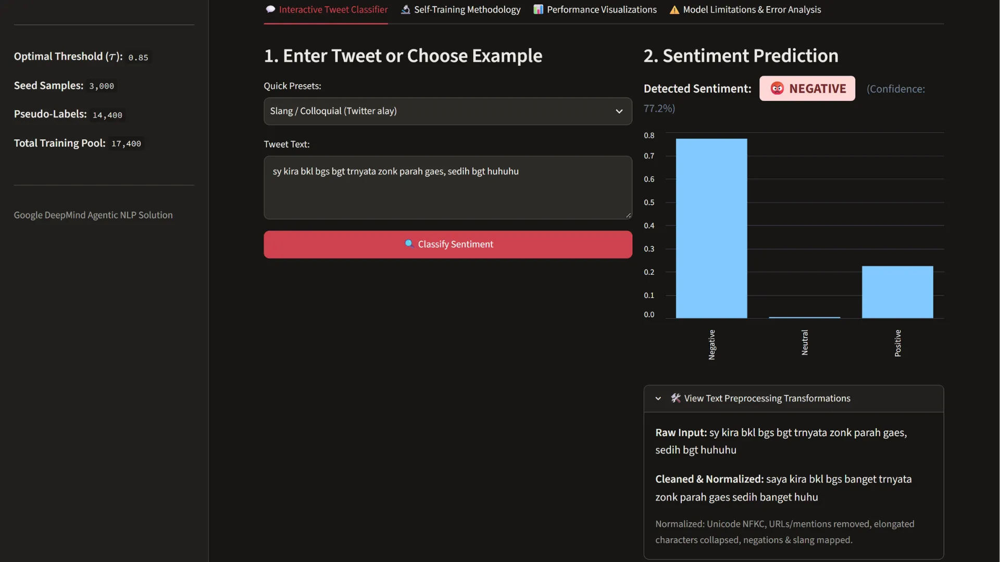
The primary Streamlit inference interface classifying an informal Indonesian slang tweet (`sy kira bkl bgs bgt trnyata zonk parah gaes, sedih bgt huhuhu`) as `NEGATIVE` with `77.2%` confidence, alongside per-class probability bars and the expanded preprocessing normalization diff (`saya`, `banget`, `huhu`).

### 2. Semi-Supervised Methodology Overview Tab
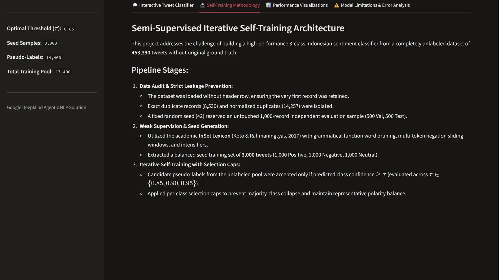
The in-app methodology documentation panel summarizing leakage-free deduplication (`453,390` raw tweets, `14,257` normalized duplicates, `1,000` held-out evaluation samples), InSet weak-supervision seed extraction (`3,000` balanced records), and capped multi-threshold self-training.

### 3. Performance Visualizations Dashboard Tab
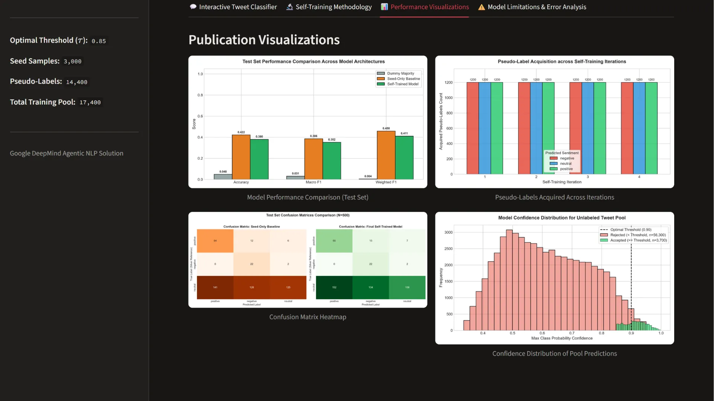
A 2x2 Streamlit dashboard view presenting the test-set model comparison, per-iteration pseudo-label counts (`1,200` per class), side-by-side baseline vs. self-trained confusion matrices, and unlabeled pool prediction confidence histogram.

### 4. Model Limitations & Linguistic Error Analysis Tab
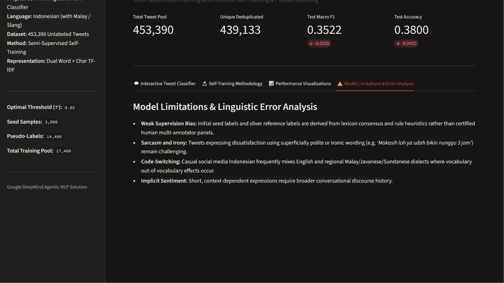
The Streamlit diagnostics view highlighting the four core constraints documented in this study: weak-supervision bias in silver labels, sarcasm and irony inversion, regional dialect and Malay code-switching out-of-vocabulary effects, and implicit context-dependent sentiment.

### 5. Unlabeled Pool Confidence, Term Frequency, Text Length & Label Provenance
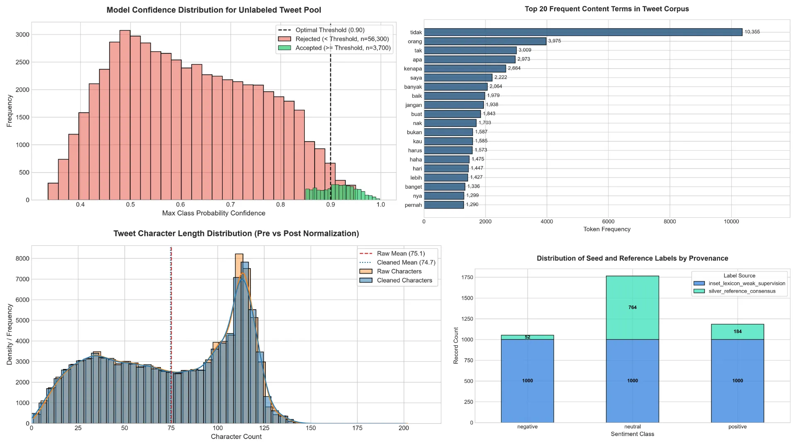
A four-panel analytical summary showing the unlabeled pool max-probability distribution (accepted vs. rejected around threshold), top 20 corpus content terms led by `tidak` (`10,355` occurrences), raw vs. cleaned tweet character-length distributions (mean `75.1` vs. `74.7` in sample), and stacked label counts split between `inset_lexicon_weak_supervision` and `silver_reference_consensus`.

### 6. Confidence Threshold Optimization & Pseudo-Label Acquisition Across Iterations
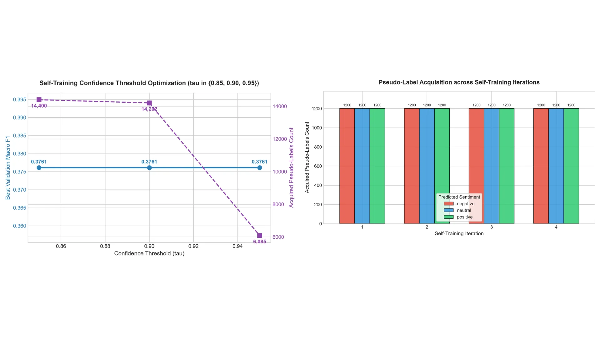
Dual-axis threshold comparison across $\tau \in \{0.85, 0.90, 0.95\}$ showing flat best validation Macro F1 (`0.3761`) alongside pseudo-label yield (`14,400`, `14,202`, and `6,085`), paired with balanced `1,200`-per-class pseudo-label acquisition across Iterations 1–4 at $\tau=0.85$.

### 7. Dataset Quality Audit & Linguistic Error Distribution
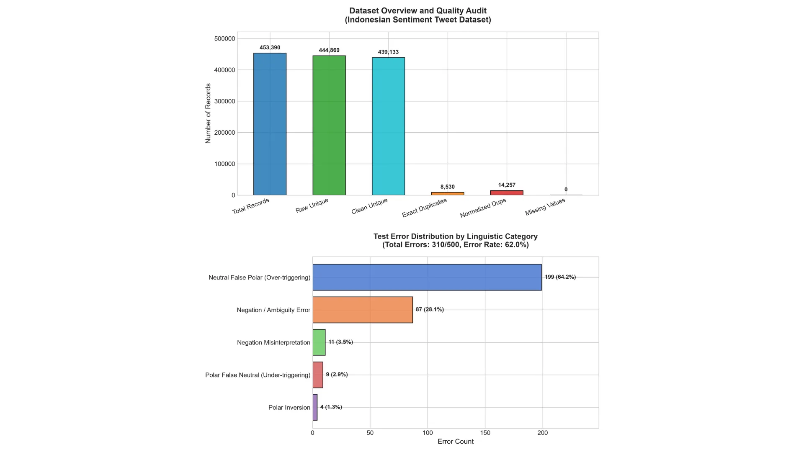
Corpus quality breakdown verifying `453,390` total records, `439,133` clean unique entries, `14,257` normalized duplicates, and `0` missing values, paired with the test-set error taxonomy across `310` errors (`64.2%` Neutral False Polar over-triggering and `28.1%` Negation / Ambiguity errors).

### 8. Per-Class Test Metrics & Cross-Architecture Performance Comparison
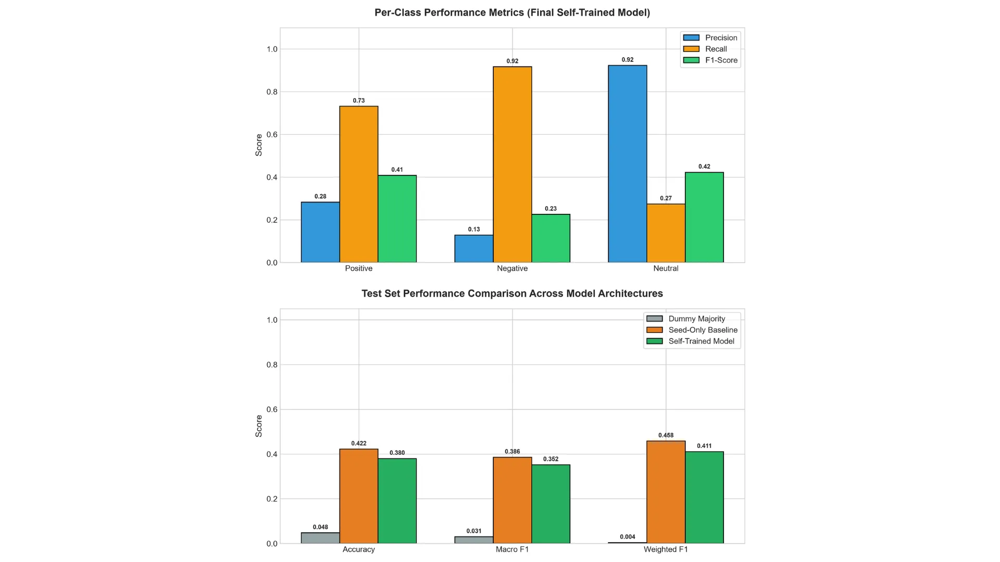
Per-class test scores for the Final Self-Trained Model (Positive `0.41` F1 / `0.73` Recall, Negative `0.23` F1 / `0.92` Recall, Neutral `0.92` Precision / `0.42` F1) compared against the Seed-Only Baseline (`0.422` Accuracy, `0.386` Macro F1, `0.458` Weighted F1) and Dummy Majority (`0.048` Accuracy, `0.031` Macro F1).

### 9. Test Set Confusion Matrices Comparison (Seed-Only Baseline vs. Self-Trained Model)
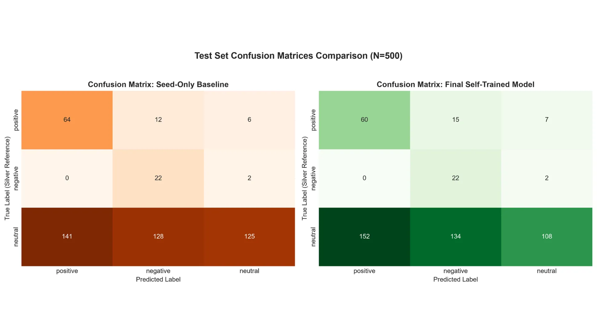
Side-by-side 3x3 confusion matrices on the 500-tweet test set illustrating identical `22/24` Negative recall in both models, alongside increased neutral-to-polar spillovers (`152` Positive and `134` Negative false triggers on `394` Neutral tweets) after 4 rounds of self-training.

## Prerequisites

- **Operating System:** Windows, Linux, or macOS (CPU-only execution supported; no GPU or CUDA required)
- **Python:** Python 3.10 or newer
- **Package Manager:** `pip` with virtual environment support (`venv`)
- **Dependencies:** Packages listed in [`requirements.txt`](requirements.txt) (`pandas`, `numpy`, `scikit-learn`, `scipy`, `matplotlib`, `seaborn`, `joblib`, `streamlit`, `requests`, `nbformat`)

## Installation & Setup

1. Clone the repository and navigate to the project root:
   ```bash
   git clone https://github.com/weztcy/Self-Training-for-Indonesian-Tweet-Sentiment-Classification.git
   cd "Self-Training for Indonesian Tweet Sentiment Classification"
   ```
2. Create and activate a Python virtual environment:
   ```bash
   python -m venv .venv
   # Windows PowerShell:
   .venv\Scripts\Activate.ps1
   # Linux/macOS:
   source .venv/bin/activate
   ```
3. Install all required Python dependencies:
   ```bash
   pip install -r requirements.txt
   ```

## Usage & Execution

You can either run the pre-trained models interactively through the Streamlit application or execute individual pipeline scripts from the repository root:

1. **Launch the Interactive Streamlit Classifier:**
   ```bash
   streamlit run streamlit/streamlit_app.py
   ```
2. **Inspect Saved Model Inference Programmatically:**
   ```python
   import joblib
   from src.data_preprocessing import clean_tweet

   model = joblib.load("models/final_model/model.joblib")
   cleaned = clean_tweet("Pelayanannya ramah banget dan cepat!")
   print(model.predict([cleaned])[0], model.predict_proba([cleaned])[0])
   ```
3. **Note on Script Output Paths:** Running [`src/train_baseline.py`](src/train_baseline.py), [`src/self_training.py`](src/self_training.py), [`src/evaluation.py`](src/evaluation.py), and [`src/visualization.py`](src/visualization.py) writes fresh metrics, predictions, and figures under `outputs/metrics/`, `outputs/predictions/`, and `outputs/figures/` while preserving the committed baseline artifacts in `metrics/`, `figures/`, and `dataset/test_predictions.csv`.

## Reproducibility & Execution

All data splits, seed sampling, and `LogisticRegression` initializations fix `random_state=42` (`dataset/processed/splits_metadata.json`). Deterministic CPU training and evaluation can be repeated from the raw CSV in `dataset/original/` using the sequential pipeline below:

1. Run text normalization and corpus auditing:
   ```bash
   python src/data_preprocessing.py
   ```
2. Partition validation/test sets, compute silver consensus & Cohen's Kappa, and extract 3,000 balanced weak seeds:
   ```bash
   python src/labeling.py
   ```
3. Fit the Dummy Majority and Seed-Only Logistic Regression baseline models:
   ```bash
   python src/train_baseline.py
   ```
4. Execute the multi-threshold iterative self-training sweep ($\tau \in \{0.85, 0.90, 0.95\}$):
   ```bash
   python src/self_training.py
   ```
5. Evaluate baseline vs. self-trained models on the held-out test set and generate the linguistic error breakdown:
   ```bash
   python src/evaluation.py
   ```
6. Regenerate all analytical figures:
   ```bash
   python src/visualization.py
   ```

Note that [`src/self_training.py`](src/self_training.py) samples 10,000 confidence records per iteration without passing an explicit NumPy seed for the visualization sample `confidence_sample.csv.gz`, so that diagnostic subsample varies slightly across runs while model splits, weights, and evaluation metrics remain deterministic under `random_state=42`.

## Contributing

Contributions to improve Indonesian slang normalization, lexical coverage, or semi-supervised calibration are welcome. Please follow these steps:

1. Fork the repository.
2. Create a branch for the change.
3. Make the changes.
4. Run relevant checks or tests when available.
5. Commit and push the branch.
6. Open a pull request with a clear explanation.

## License

This project is licensed under the MIT License.
See the [LICENSE](LICENSE) file for details.

## Author & Contact

**Yohanes Dimas Pratama**

- GitHub: [github.com/weztcy](https://github.com/weztcy)
- Portfolio: [yohanesdimas.com](https://yohanesdimas.com)
- LinkedIn: [linkedin.com/in/yohanes-dimas](https://www.linkedin.com/in/yohanes-dimas)
